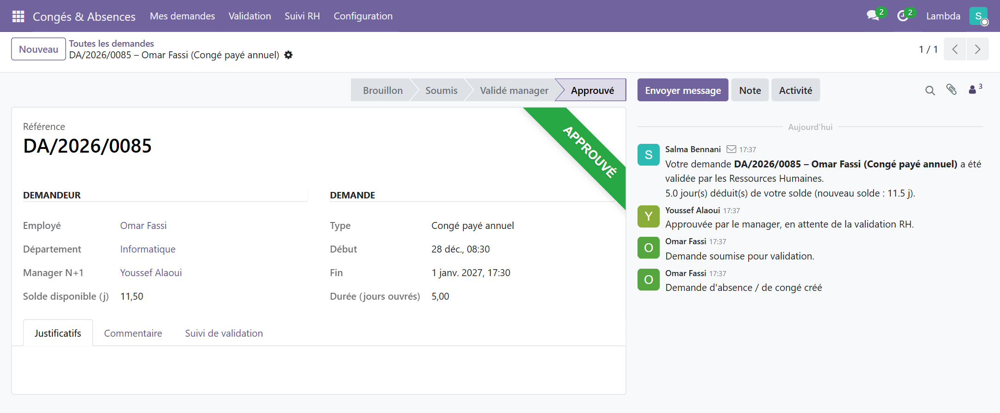
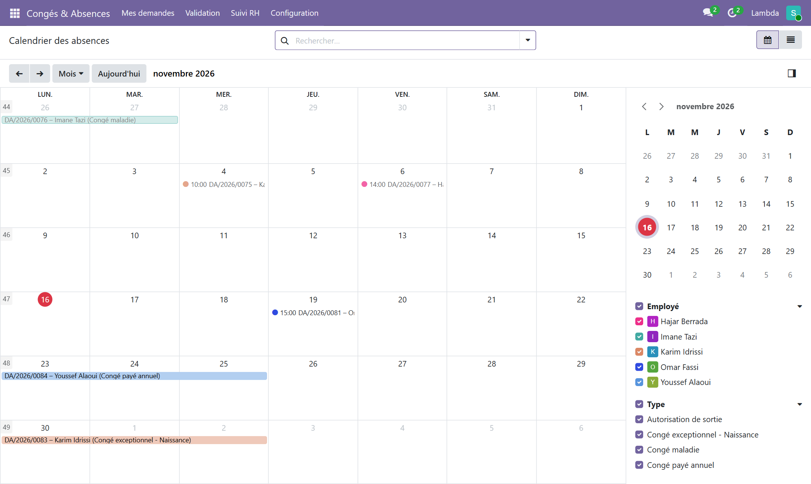
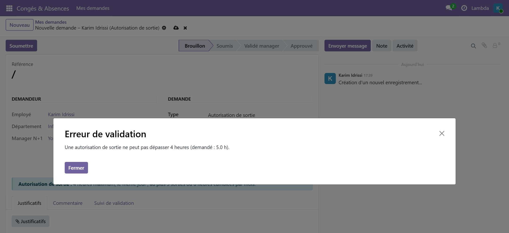
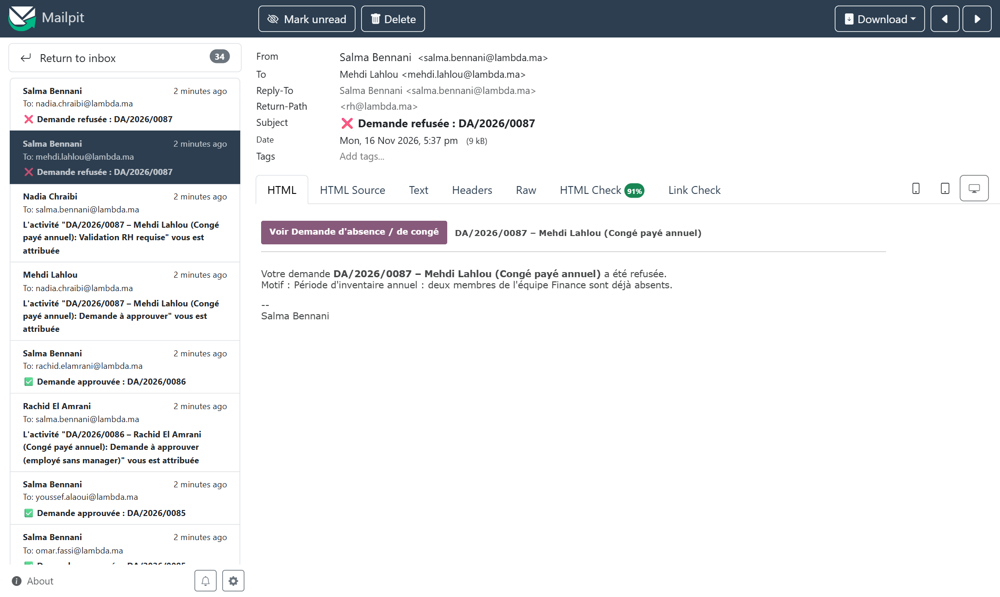

<p align="center">
  
</p>

<h1 align="center">Congés & Absences</h1>

<p align="center">
  Module <b>Odoo 19</b> de gestion des autorisations d'absence et des congés,<br>
  avec circuit de validation Manager N+1 → Responsable RH.
</p>

<p align="center">
  
  
  
  
  
  
</p>

<p align="center">
  <a href="docs/rapport/rapport.pdf"><b>📄 Rapport technique (PDF)</b></a> ·
  <a href="docs/uml/">Diagrammes UML</a> ·
  <a href="#installation">Installation</a> ·
  <a href="#données-de-démonstration--la-société-lambda">Démonstration</a>
</p>

---

Mini-projet du module **Systèmes Intégrés** – INSEA, filière M2SI, année universitaire 2026–2027.
Réalisé par **KADADE MAHAMADOU Bassirou**, sous l'encadrement de **Pr. OURADI Najib**.

Le module technique **`insea_hr_leave_custom`** dématérialise le circuit RH de la société Lambda :

- **Autorisations de sortie** : absences courtes (≤ 4 h, le même jour), plafond de 3 sorties ou 8 h par mois, motif obligatoire
- **Congés légaux** : congé payé annuel, congé exceptionnel (mariage 4 j, naissance 3 j, décès 3 j), congé maladie
- **Workflow de validation** : Brouillon → Soumis → Validé manager → Approuvé / Refusé (motif obligatoire)
- **Contrôles automatiques** : solde disponible (1,5 j acquis par mois), non-chevauchement, délai de prévenance de 7 jours, justificatifs
- **Sécurité** : l'employé voit ses demandes, le manager son équipe, le RH l'ensemble
- **Notifications** : activités et e-mails à chaque étape (capturés localement par Mailpit)

## Aperçu

| Formulaire et circuit de validation | Calendrier des absences |
|---|---|
|  |  |
| **Contrôle d'une règle de gestion** | **Notification par e-mail (Mailpit)** |
|  |  |

## Démarrage rapide

```bash
git clone https://github.com/BassirouKadade/odoo-conges-absences.git
cd odoo-conges-absences
cp .env.example .env
cp config/odoo.conf.example config/odoo.conf   # puis adapter les mots de passe
docker compose up -d                           # Odoo : http://localhost:8070 · Mailpit : http://localhost:8025
```

Créer ensuite la base depuis http://localhost:8070 puis installer l'application **Congés & Absences** (voir [Installation](#installation)).

## Sommaire

1. [Acteurs](#acteurs)
2. [Structure du projet](#structure-du-projet)
3. [Architecture technique](#architecture-technique)
4. [Installation](#installation)
5. [Installer le module](#installer-le-module)
6. [Développement](#développement)
7. [Documentation UML](#documentation-uml)
8. [Commandes utiles](#commandes-utiles)
9. [Dépannage](#dépannage)
10. [Licence](#licence)

## Acteurs

| Acteur | Rôle | Visibilité des demandes |
|---|---|---|
| **Employé** | Crée, justifie et soumet ses demandes, consulte son solde | Les siennes |
| **Manager (N+1)** | Approuve ou refuse les demandes de son équipe (validation finale des sorties ≤ 4 h) | Son équipe |
| **Responsable RH** | Seconde validation des congés, vérifie les justificatifs, gère les soldes. Il est aussi **administrateur fonctionnel** (paramétrage des types et règles) | Toutes |
| **Administrateur système** | Installe le module, gère les utilisateurs, les groupes et la hiérarchie | Configuration technique |
| **Système (cron)** | Ajoute 1,5 jour par mois au solde, exécute les contrôles, envoie les notifications | (acteur secondaire) |

## Structure du projet

```
odoo-conges-absences/
├── docker-compose.yml          # Pile Odoo 19 + PostgreSQL 16 + Mailpit (noms préfixés insea-hr)
├── .env.example                # Modèle des variables (copier en .env)
├── .env                        # Mots de passe et port (NON versionné)
├── config/
│   ├── odoo.conf.example       # Modèle de configuration Odoo
│   └── odoo.conf               # Configuration réelle (NON versionnée)
├── addons/
│   └── insea_hr_leave_custom/  # Le module développé (Python + XML, 49 tests)
├── docs/
│   ├── rapport/                # Rapport technique (PDF + source LaTeX + illustrations)
│   └── uml/                    # Diagrammes PlantUML (cas d'utilisation, classes, états, séquence, déploiement)
└── LICENSE                     # Licence LGPL-3
```

## Architecture technique

```
Navigateur ──HTTP :8070──► insea-hr-odoo (Odoo 19) ──SQL :5432──► insea-hr-db (PostgreSQL 16)
                               │
                               ├── ./config/odoo.conf        configuration
                               ├── ./addons                  module insea_hr_leave_custom
                               └── volume insea-hr-odoo-data pièces jointes (justificatifs), sessions
```

| Élément | Nom | Rôle |
|---|---|---|
| Projet Compose | `insea-hr-leave` | Regroupe toute la pile |
| Conteneur BD | `insea-hr-db` | PostgreSQL 16, **aucun port publié** sur l'hôte |
| Conteneur Odoo | `insea-hr-odoo` | Serveur Odoo, port hôte **8070** |
| Conteneur e-mails | `insea-hr-mailpit` | Serveur SMTP factice (Mailpit) : boîte de réception web sur le port **8025** |
| Volumes | `insea-hr-db-data`, `insea-hr-odoo-data` | Données persistantes |
| Réseau | `insea-hr-net` | Réseau privé entre les conteneurs |

> **Isolation** : tous les noms sont préfixés `insea-hr` et le port par défaut est 8070. Le projet peut donc tourner en même temps qu'un autre projet Odoo (qui utilise souvent `odoo`, `odoo-db` et le port 8069) sans collision.

## Installation

**Prérequis** : Docker Desktop avec Docker Compose v2, port 8070 libre, environ 1,5 Go d'espace disque.

```bash
# 1. Créer les fichiers de configuration à partir des modèles
cp .env.example .env
cp config/odoo.conf.example config/odoo.conf

# 2. Modifier les mots de passe :
#    - DB_PASSWORD dans .env
#    - admin_passwd (mot de passe maître) dans config/odoo.conf

# 3. Démarrer la pile
docker compose up -d
docker compose ps      # les trois services doivent passer à l'état "healthy"
```

### Créer la base

1. Ouvrir http://localhost:8070.
2. Remplir le formulaire :
   - **Master Password** : la valeur de `admin_passwd`
   - **Database Name** : `insea_hr`
   - **Email** et **Password** du compte administrateur
   - **Language** : Français, **Country** : Maroc
   - **Demo data** : décoché (le module fournit son propre jeu de données)
3. Cliquer sur **Create database**.

## Installer le module

1. Activer le **mode développeur** : Paramètres → Activer le mode développeur.
2. **Applications → Mettre à jour la liste des applications**.
3. Rechercher `insea_hr_leave_custom` et cliquer sur **Activer**.

Le module dépend de `hr` (Employés) et `mail` (chatter et notifications), qui s'installent automatiquement.

## E-mails : boîte de réception de test (Mailpit)

Odoo envoie ses e-mails au conteneur **Mailpit** (`smtp_server = mailpit` dans `config/odoo.conf`).
Mailpit les capture et les affiche sur **http://localhost:8025** : **aucun e-mail ne part sur Internet**.

| Événement | Destinataire | Canal |
|---|---|---|
| Demande soumise | Manager N+1 | Activité « Demande à approuver » + e-mail |
| Validée par le manager (congé) | Responsable(s) RH | Activité « Validation RH requise » + e-mail |
| Approuvée | Employé (+ abonnés) | E-mail « ✅ Demande approuvée » |
| Refusée | Employé (+ abonnés) | E-mail « ❌ Demande refusée », avec le motif |

Chaque utilisateur choisit son canal dans *Préférences → Notification* : **par e-mail** (visible dans Mailpit) ou **dans Odoo** (icône Discussion).

## Données de démonstration : la société « Lambda »

Le module fournit un jeu de données réaliste. Les demandes sont déroulées **dans le vrai workflow**, de sorte que l'historique, les activités et les e-mails sont authentiques. Les dates sont calculées par rapport au jour du chargement.

**Comptes** (mot de passe commun : `lambda2026`) :

| Identifiant | Nom | Rôle | Manager |
|---|---|---|---|
| `rachid.elamrani@lambda.ma` | Rachid El Amrani | Directeur Général (manager) | – |
| `salma.bennani@lambda.ma` | Salma Bennani | **Responsable RH** | Rachid |
| `youssef.alaoui@lambda.ma` | Youssef Alaoui | Manager Informatique | Rachid |
| `nadia.chraibi@lambda.ma` | Nadia Chraibi | Manager Finance | Rachid |
| `karim.idrissi@lambda.ma` | Karim Idrissi | Employé (Informatique) | Youssef |
| `imane.tazi@lambda.ma` | Imane Tazi | Employée (Informatique) | Youssef |
| `omar.fassi@lambda.ma` | Omar Fassi | Employé (Informatique) | Youssef |
| `hajar.berrada@lambda.ma` | Hajar Berrada | Employée (Finance) | Nadia |
| `mehdi.lahlou@lambda.ma` | Mehdi Lahlou | Employé (Finance) | Nadia |

**16 demandes** couvrant tous les états : brouillons, soumises, en attente RH (dont une sans justificatif), approuvées, refusées par le manager et par le RH.

```bash
# Charger la démo sur une base existante (une seule fois)
echo "env['insea.leave.demo'].load(); env.cr.commit()" | docker exec -i insea-hr-odoo bash -c \
  'odoo shell --db_host="$HOST" --db_user="$USER" --db_password="$PASSWORD" -d insea_hr --no-http'

# Réinitialiser puis recharger une démo propre (avant la soutenance)
echo "env['insea.leave.demo'].reset(); env.cr.commit(); env['insea.leave.demo'].load(); env.cr.commit()" | \
  docker exec -i insea-hr-odoo bash -c \
  'odoo shell --db_host="$HOST" --db_user="$USER" --db_password="$PASSWORD" -d insea_hr --no-http'
```

> Sur une base créée **avec** les données de démo, le jeu Lambda est chargé automatiquement à l'installation du module.

## Développement

Après une modification du code Python ou XML, mettre le module à jour :

```bash
docker exec -it insea-hr-odoo odoo -d insea_hr -u insea_hr_leave_custom --stop-after-init
docker compose restart odoo
```

Pour suivre les logs en direct :

```bash
docker compose logs -f odoo
```

### Tests automatisés

Le module embarque 49 tests (dossier `addons/insea_hr_leave_custom/tests/`) :

| Fichier | Contenu |
|---|---|
| `test_business_rules.py` | Sortie ≤ 4 h, plafond 3 sorties / 8 h par mois, non-chevauchement, solde, délai de 7 jours, durée max des congés exceptionnels |
| `test_workflow.py` | Circuit Brouillon → Soumis → Manager → RH, refus avec motif, justificatif, activités, transitions interdites |
| `test_security.py` | Record rules (employé / manager / RH), droits de validation, configuration réservée au RH |
| `test_accrual.py` | Acquisition mensuelle de 1,5 j, idempotence de la tâche planifiée, ajustements RH |

Lancer les tests sur la base de test (le port 8099 évite le conflit avec le serveur en cours) :

```bash
docker exec insea-hr-odoo bash -c 'odoo --db_host="$HOST" --db_user="$USER" --db_password="$PASSWORD" \
  -d insea_hr_test -u insea_hr_leave_custom --test-tags /insea_hr_leave_custom \
  --http-port=8099 --stop-after-init'
```

Résultat attendu en fin de log : `0 failed, 0 error(s) of 49 tests`.

### Rappels Odoo 19

- Les vues liste s'écrivent `<list>` (et non plus `<tree>`).
- `attrs` et `states` sont supprimés : utiliser `invisible="..."`, `readonly="..."` et `required="..."` avec une expression Python.

## Rapport technique

Le rapport du mini-projet est dans [`docs/rapport/rapport.pdf`](docs/rapport/rapport.pdf), avec sa source LaTeX (`rapport.tex`) et ses illustrations (`img/`). Pour le recompiler :

```bash
cd docs/rapport && latexmk -pdf rapport.tex
```

Les informations de la page de garde (auteurs, encadrant, niveau) sont définies en tête de `rapport.tex`.

## Documentation UML

Les diagrammes sont dans [`docs/uml/`](docs/uml/) au format **PlantUML** :

| Fichier | Contenu |
|---|---|
| `cas_utilisation/uc_0_vue_ensemble.puml` | Vue d'ensemble : acteurs et grands domaines |
| `cas_utilisation/uc_1_demandes.puml` | Demandes de l'employé et contrôles de cohérence |
| `cas_utilisation/uc_2_validation.puml` | Circuit de validation Manager / RH |
| `cas_utilisation/uc_3_administration.puml` | Gestion RH, administration technique, cron |
| `diagramme_classes.puml` | Classes Odoo standard (gris), étendues `_inherit` (orange), créées `_name` (vert) |
| `diagramme_etats_transitions.puml` | Cycle de vie d'une demande (draft → submitted → manager_approved → approved / refused) |

Les images PNG sont générées dans `docs/out/` (non versionné).

Pour les visualiser : extension VS Code *PlantUML* (`Alt+D`), avec le réglage `"plantuml.render": "Local"` (Java + Graphviz). Si l'aperçu affiche une image cassée, ajouter `"plantuml.commandArgs": ["-Xshare:off"]` : certaines JVM écrivent un avertissement sur la sortie standard, ce qui corrompt le SVG. Les diagrammes rendus sont aussi disponibles en PNG dans `docs/rapport/img/uml/`.

Pour tout regénérer en ligne de commande :

```bash
java -jar ~/.vscode/extensions/jebbs.plantuml-*/plantuml.jar -charset UTF-8 -o ../out docs/uml/diagramme_classes.puml
java -jar ~/.vscode/extensions/jebbs.plantuml-*/plantuml.jar -charset UTF-8 -o ../../out docs/uml/cas_utilisation/uc_*.puml
```

## Commandes utiles

| Action | Commande |
|---|---|
| Démarrer | `docker compose up -d` |
| Arrêter (sans perte de données) | `docker compose stop` |
| Arrêter et supprimer les conteneurs | `docker compose down` |
| Logs Odoo | `docker compose logs -f odoo` |
| Shell dans Odoo | `docker exec -it insea-hr-odoo bash` |
| Shell Odoo (Python) | `docker exec -it insea-hr-odoo odoo shell -d insea_hr` |
| Mettre à jour le module | `docker exec -it insea-hr-odoo odoo -d insea_hr -u insea_hr_leave_custom --stop-after-init` |
| Sauvegarder la base (SQL seul) | `docker exec insea-hr-db sh -c 'pg_dump -U "$POSTGRES_USER" insea_hr' > backup.sql` |
| **Tout supprimer, données comprises** ⚠️ | `docker compose down -v` |

> Une sauvegarde complète d'une base Odoo comprend la base PostgreSQL **et** le filestore (justificatifs téléversés). Le plus simple est d'utiliser http://localhost:8070/web/database/manager → **Backup** (format zip).

## Dépannage

| Problème | Solution |
|---|---|
| Page inaccessible alors que le conteneur tourne | Vérifier `http_interface = 0.0.0.0` dans `config/odoo.conf` |
| « Access Denied » à la création de la base | Le Master Password ne correspond pas à `admin_passwd` |
| Port 8070 déjà utilisé | Changer `ODOO_PORT` dans `.env` |
| Changement de `DB_PASSWORD` sans effet | PostgreSQL ne lit ce mot de passe qu'à la première initialisation : `docker compose down -v` (⚠️ supprime les données) |
| Le module n'apparaît pas dans Applications | Mode développeur activé ? Puis *Mettre à jour la liste des applications* |
| Conteneur `unhealthy` | `docker compose logs odoo db` |

## Licence

Le module est distribué sous licence **LGPL-3** (voir [LICENSE](LICENSE)), comme indiqué dans son `__manifest__.py`.
Les logos de l'INSEA et du HCP présents dans le rapport restent la propriété de leurs institutions.
